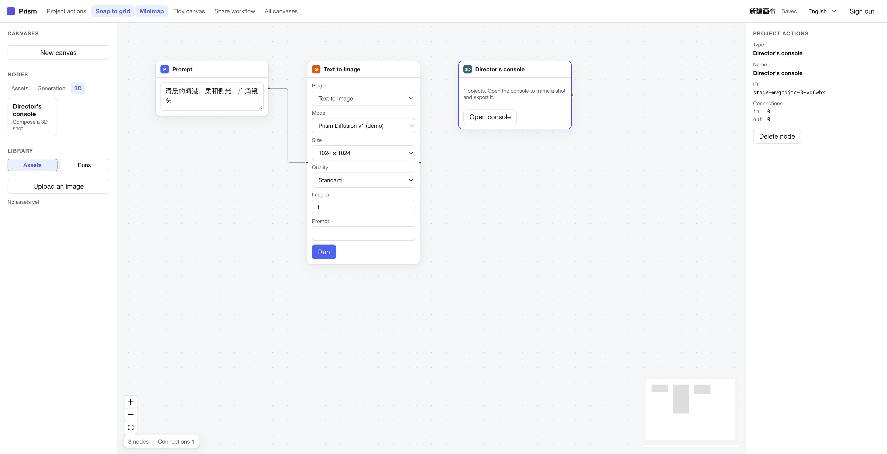
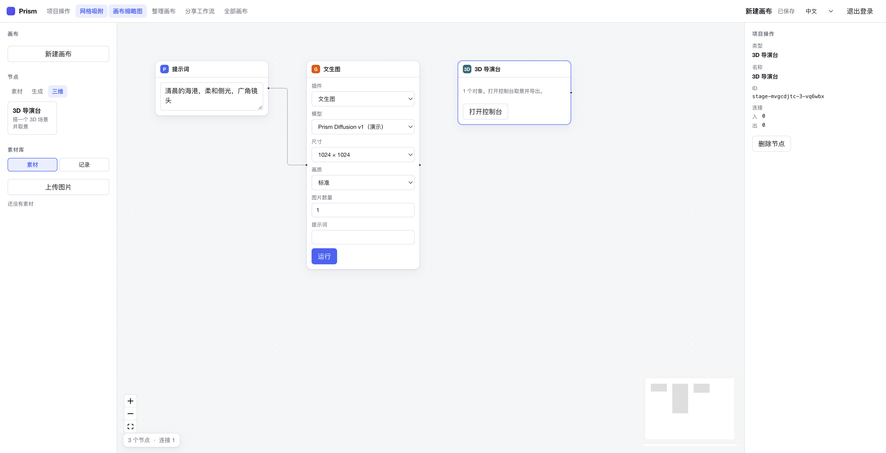
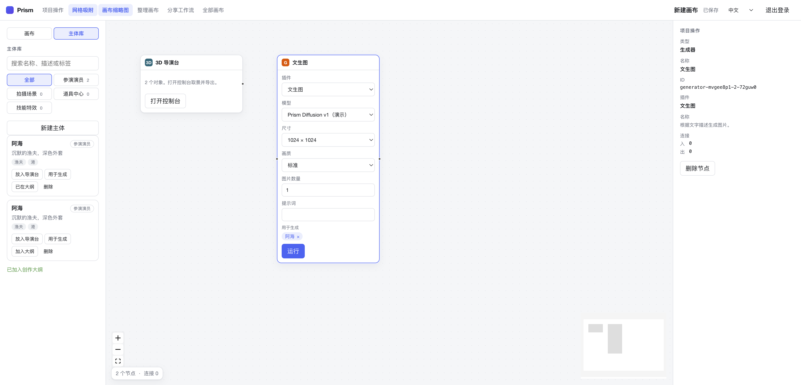
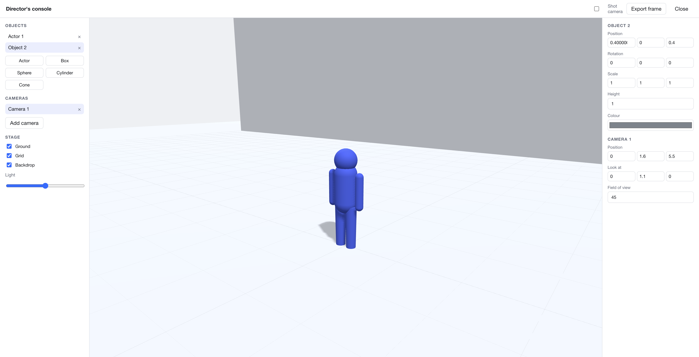

# Prism

An open-source node canvas for AI media generation.

Prism is a small, self-hostable creative tool: you arrange prompts, images and
generators on an infinite canvas, wire them together, and run the graph. The
server owns the graph — it reads the stored document to decide what each
generator consumed — so a run is reproducible and auditable.

It ships with a built-in generation backend, which means you can clone the
repository and have a working product without any third-party credentials. Point
it at a different provider when you are ready.



<p align="center">
  
</p>

<p align="center">
  
</p>

### Languages

The interface ships in English and Simplified Chinese, and the language can be
switched from the top bar. The choice is remembered per browser. Labels that
come from the server — plugin names, model names, parameter names — carry a
translation key, so a deployment can add its own models without having to
translate them.

```
┌────────────┐        ┌──────────────────────┐        ┌─────────────┐
│  prompt    │───────▶│  generator (plugin)  │───────▶│  result     │
│  (text)    │  slot  │  runs a model        │        │  (images)   │
└────────────┘        └──────────────────────┘        └─────────────┘
                              │
                              ▼
                    POST /api/canvases/:id/runs
                              │
                    ┌─────────▼──────────┐
                    │  task queue        │  queued → running → succeeded
                    │  provider adapter  │
                    └─────────┬──────────┘
                              ▼
                       assets on disk
```

## Features

- **Infinite canvas** built on [Vue Flow](https://vueflow.dev) — pan, zoom,
  minimap, snap-to-grid, and a node inspector. The viewport is saved with the
  document, so reopening a canvas returns to where you left it.
- **Declarative plugins.** A generator is described by a manifest: the input
  slots it consumes, the output it produces, and the parameters the user can
  change. Adding a generator never touches the canvas code.
- **The server resolves the graph.** A run request names a node and its
  parameters; the server walks the stored document, collects the values on the
  wires feeding that node, and composes the prompt. A run also carries a
  fingerprint of the document, so the server refuses to work against a graph
  that is older than the one on screen.
- **Results feed the next step.** A finished run leaves a node — an image node
  for image outputs, a text node for text outputs — wired to the generator
  that produced it. A result with several outputs lets you pick which one
  travels along the wire.
- **A real task queue.** Runs are persisted, picked up by a worker with a
  concurrency limit, and polled until they settle. A restart does not lose
  work: interrupted runs are picked up again, and a run that cannot be
  resumed says so instead of hanging.
- **Pluggable providers.** A small adapter interface with three
  implementations out of the box: a local backend that needs no credentials,
  and adapters for the GPT Image and DALL·E dialects of the OpenAI image API.
- **You choose the model.** A generator node lists the models the deployment
  can serve, and the parameters on the node are the ones that model accepts —
  a quality of `high` means something different to a different family, so the
  values are checked before the request is sent.
- **Local runtimes.** Generators that do not need a model at all run in
  process. `Upscale` is one of them: it resamples the source image with a
  Lanczos kernel, so the result really is the input at a larger size.
- **A 3D stage.** A stage node opens a console where you place actors, props
  and scenery, frame the shot with a camera, and export that view as an
  image you can feed into a generator. The scene is saved with the canvas.
  
- **A library.** Every asset and every run is listed next to the canvas, and
  a click puts the result back on the canvas.
- **Subjects and an outline.** A production is built from reusable *subjects*:
  actors, scenes, props and effects. They live in a library that belongs to the
  account, so the same character can be used in as many productions as you
  want. Each production keeps an outline of the subjects it uses, and a
  subject can be dropped into the 3D stage or attached to a generator, where
  its description joins the prompt and its image becomes a reference. The link
  survives a save: reopening the canvas restores the outline, the staged object
  and the generator's subjects.
- **The shortcuts a canvas editor is expected to have.** Undo and redo, copy
  and paste, delete, save, and a command to lay the nodes out again.
- **Honest output.** The built-in backend marks what it produces: those
  results are flagged as synthetic, labelled as such on the node, and carry a
  hatch pattern so nobody mistakes them for a model output.

## Requirements

- Node.js 22.19 or newer (the server uses the built-in `node:sqlite` module)
- pnpm 10 or newer

## Getting started

```bash
pnpm install
pnpm build          # builds the shared contracts first
pnpm dev            # server on :4319, web app on :5173
```

Open <http://127.0.0.1:5173>, create an account, and the workspace opens with
an empty canvas.

Add a **Prompt** node, a **Generator** node, drag from the prompt's output
handle to the generator's `Prompt` input, and press **Run**.

### Checking a change

```bash
pnpm typecheck     # tsc across the workspace
pnpm test          # unit tests
pnpm smoke         # end-to-end, needs a running server
pnpm test:recovery # interrupts a run and checks it recovers
```

`pnpm smoke` covers the paths that are easy to get subtly wrong: a run against
a changed graph is refused, a result can be wired into the next generator, a
reference image reaches the backend, an upscale is twice the size of its
input, and a demo result is flagged as one.

## Configuration

The server reads its configuration from the environment. Everything has a
sensible default; see `.env.example` for the full list.

| Variable | Default | Purpose |
| --- | --- | --- |
| `PRISM_HOST` | `127.0.0.1` | Bind address |
| `PRISM_PORT` | `4319` | Bind port |
| `PRISM_DATA_DIR` | `./data` | Database and asset storage |
| `PRISM_WORKER_CONCURRENCY` | `2` | Runs executed in parallel |
| `PRISM_POLL_INTERVAL_MS` | `1500` | How often a worker checks on a run |
| `PRISM_PUBLIC_BASE_URL` | `http://127.0.0.1:<port>` | Base URL used in asset links |
| `PRISM_ALLOW_SIGNUP` | `true` | Allow new accounts |
| `PRISM_OPENAI_BASE_URL` | `https://api.openai.com/v1` | Image endpoint |
| `PRISM_OPENAI_API_KEY` | — | Enables the models that endpoint serves |

With `PRISM_OPENAI_API_KEY` set, the models that endpoint serves appear in
the model list on a generator node, and picking one routes the run there
instead of to the built-in backend. A run against a remote model is not
marked as a demo.

The endpoint is spoken to in the OpenAI image dialect, and the request is
shaped for the model you picked:

- the **GPT Image** family always returns base64 and rejects the legacy
  `response_format` field, so it is never sent; it takes `background` and
  `output_format` instead;
- the **DALL·E** family expects `response_format` and knows only its own
  quality names, and it cannot work from a reference image.

## Layout

```
packages/contracts   Shared wire types: documents, manifests, runs, assets
apps/server          Fastify API, SQLite storage, task runner, providers
apps/web             Vue 3 client with the canvas editor
scripts/smoke.mjs    End-to-end check against a running server
docs/                Architecture notes and the plugin reference
```

## Writing a plugin

A plugin is a manifest. Drop it into `apps/server/src/plugins/catalog.ts`:

```ts
{
  id: "text-to-image",
  name: "Text to Image",
  version: "1.0.0",
  category: "generation",
  summary: "Generate an image from a written description.",
  icon: "sparkle",
  inputs: [
    { key: "prompt", label: "Prompt", dataType: "text", required: false, min: 0, max: 1 },
  ],
  outputs: [
    {
      key: "images",
      label: "Images",
      dataType: "image",
      params: [
        { key: "ratio", label: "Aspect ratio", type: "enum", default: "1:1",
          options: [{ value: "1:1", label: "1:1" }] },
      ],
    },
  ],
  defaults: { ratio: "1:1" },
  runtime: { kind: "provider", modelKey: "prism-diffusion-v1" },
  enabled: true,
}
```

The input slot key is the address of the slot: an edge that delivers a value
into the generator names it in its `targetHandle` as `slot:<key>`, and the
collected values are handed to the provider under the same key.

See [docs/plugin-schema.md](docs/plugin-schema.md) for the full reference and
[docs/architecture.md](docs/architecture.md) for how a run travels through the
system.

## API

All routes live under `/api` and require `Authorization: Bearer <token>`
except for registration and login.

| Method | Path | Purpose |
| --- | --- | --- |
| `POST` | `/api/auth/register` | Create an account, returns a token |
| `POST` | `/api/auth/login` | Exchange credentials for a token |
| `GET` | `/api/auth/me` | Current user |
| `GET` | `/api/canvases` | List canvases |
| `POST` | `/api/canvases` | Create a canvas |
| `GET` | `/api/canvases/:id` | Read a canvas and its document |
| `PATCH` | `/api/canvases/:id` | Rename a canvas or replace its document |
| `DELETE` | `/api/canvases/:id` | Delete a canvas |
| `GET` | `/api/plugins` | Plugin catalog |
| `GET` | `/api/models` | Model catalog |
| `GET` | `/api/subjects` | The subject library, with `?kind=` and `?q=` filters |
| `POST` | `/api/subjects` | Create a subject |
| `PATCH` | `/api/subjects/:id` | Update a subject |
| `DELETE` | `/api/subjects/:id` | Remove a subject |
| `GET` | `/api/assets` | Every asset of the account |
| `GET` | `/api/canvases/:id/assets` | Assets of one canvas |
| `POST` | `/api/canvases/:id/assets` | Upload a file |
| `GET` | `/api/assets/:id` | Download a file |
| `POST` | `/api/canvases/:id/runs` | Start a generation |
| `GET` | `/api/runs/:id` | Read a run |
| `GET` | `/api/canvases/:id/runs` | List the runs of a canvas |

## Keyboard shortcuts

| Shortcut | Action |
| --- | --- |
| `Ctrl`/`Cmd` + `Z` | Undo |
| `Ctrl`/`Cmd` + `Shift` + `Z` | Redo |
| `Ctrl`/`Cmd` + `C` / `V` | Copy / paste the selected node |
| `Ctrl`/`Cmd` + `S` | Save now |
| `Delete` | Remove the selected node |
| Double-click the title | Rename the canvas |

## Development

```bash
pnpm typecheck      # tsc across the workspace
pnpm build          # production build
pnpm --filter @prism/server dev
pnpm --filter @prism/web dev
```

## License

MIT — see [LICENSE](LICENSE).
